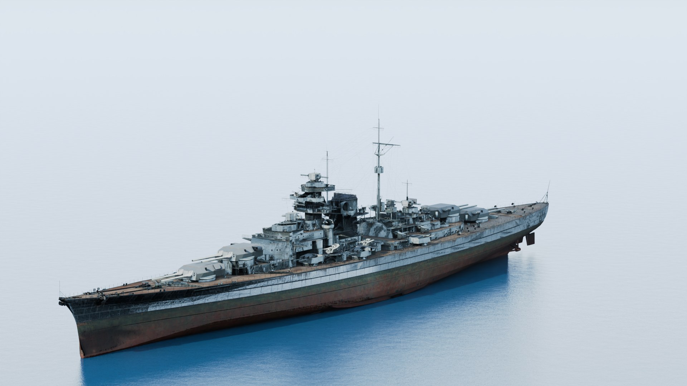

# WoWs Render — 战舰世界高清渲染管线

从 **World of Warships（战舰世界）** 游戏客户端里导出舰船 3D 模型，用 Blender + Cycles 离线渲染成高清图片。

渲染按**游戏原本的 PBS 着色方式**还原，而不只是"把模型导出来打个光"：

- **游戏原生贴图**：从资源包里取出 `_a`（颜色）、`_mg`（金属+光泽）、`_n`（法线）、`_ao`（环境光遮蔽）四套贴图
- **正确的通道语义**：`_mg` 的 R 是金属度、B 是光泽度；`_n` 的表面细节在 B 通道——都是实测推导出来的，不是猜的
- **游戏的光照结构**：单方向光 + 环境光（游戏没有补光灯），逐视角自动测光
- **GT 色调映射**：近似游戏的 `g_tonemapParams` 曲线
- **迷彩**：可解码 `camoColorMask` 并着色（真实色板未取得，用近似色）
- 自动取景：用真实顶点做投影二分搜索，任何船型都能完整装进画面
- 6 个视角 × 分辨率 1080p → **16K**，采样 32 → 256
- 两种入口：**本地网页 UI** + **命令行批量**
- 中文舰名直接从游戏自带 `global.mo` 提取，795 艘零漏配

## 效果预览



<sub>俾斯麦，1920×1080。船体锈蚀、木质甲板、炮塔金属反光、水线分界都由游戏贴图驱动。实际输出支持到 **15360×8640（16K）**。</sub>

更多样图在 `docs/screenshots/`（部分为早期管线渲染，观感与当前版本有差异）。

> **本仓库不含原始游戏素材。** 没有游戏文件、模型、贴图，也没有第三方工具二进制。
> 仓库里只有脚本、两张已生成的舰船目录 JSON，以及用于展示效果的压缩样图。
> 渲染结果是从游戏模型派生的，版权说明见 [版权与许可](#版权与许可)。

---

## 目录

- [工作流程](#工作流程)
- [游戏渲染还原](#游戏渲染还原)
- [快速开始](#快速开始)
- [网页 UI](#网页-ui)
- [命令行批量](#命令行批量)
- [参数说明](#参数说明)
- [输出结构](#输出结构)
- [中文舰名](#中文舰名)
- [性能参考](#性能参考)
- [文件说明](#文件说明)
- [配置路径](#配置路径不用改代码)
- [已知限制](#已知限制)
- [常见问题](#常见问题)

---

## 工作流程

```
游戏客户端                    _tools/                        _render/
───────────                  ─────────                      ─────────
GameParams + .geometry  ──▶  wows-gltf-exporter  ──▶  Bismarck.raw.glb
                                     │
                                     ▼
                              sanitize_glb.py（剔除空 mesh）
                                     │
        ┌────────────────────────────┘
        ▼
extract_ship_textures.py  ──▶  textures/   _a / _mg / _n / _ao (+ _camo)
        │
        ▼
Blender 4.5 + Cycles
（PBS 材质 / 自动取景 / 单方向光 / 自动测光 / GT 曲线）
        │
        ▼
WoWs_Renders/<国家>/
        <舰船Key>_<舰种>_T<级别>_<视角>_<宽>x<高>.png
        例：PGSB108_Bismarck_Battleship_T8_hero_3840x2160.png
```

五个阶段：

1. **导出** — `wows-gltf-exporter.exe` 解析模型，输出 GLB（只带颜色贴图）
2. **清理** — `sanitize_glb.py` 删掉空 mesh，否则 Blender 导入失败
3. **取贴图** — `extract_ship_textures.py` 从游戏包里取出 PBS 所需的其余贴图
4. **渲染** — `render_ship.py` 组装 PBS 材质、取景、打光、色调映射
5. **收集** — 网页 UI 内联展示；命令行直接落盘

---

## 游戏渲染还原

这一节说明"为什么这样做"，细节推导见 [`docs/game-rendering-pipeline.md`](docs/game-rendering-pipeline.md)。

### 贴图通道语义（实测）

| 贴图 | 游戏槽位 | 用法 |
|---|---|---|
| `_a` | `diffuseMap` | 颜色贴图 |
| `_mg` | `metallicGlossMap` | **R = 金属度，B = 光泽度**，粗糙度 = `1 - B` |
| `_n` | `normalMap` | **只用 R/G**，z 由 `sqrt(1-x²-y²)` 重建 |
| `_ao` | `ambientOcclusionMap` | 乘到颜色上 |
| `_camo` | `camoColorMask` | R/G/B 索引涂装区，按色板着色 |

`_mg` 的通道顺序是靠材质区域统计定下来的：灰色油漆区 B≈0.38，锈蚀/木材/船底 B≈0.00——所以 **B 是光泽度**，搞反了炮管和甲板会全错。

`_n` 的平坦区 B 通道均值只有 0.45，且与真实 z 呈**负相关（-0.12）**，不是法线分量。一开始当 z 用，船体大面积发黑、亮度掉 7 级。

### 与游戏的差距

| 项 | 游戏 | 本仓库 |
|---|---|---|
| 光照 | 单方向光 + PMREM 环境 | 单方向光 + 物理天空环境光 |
| 曝光 | `wg_average_luminance` 测光 | 逐视角低采样探针测光 |
| 色调映射 | GT 曲线（`gtBlack/gtContrast/...`） | CurveRGB 近似同参数 |
| 迷彩色板 | `camoColor` | **未取得**，用近似军灰 |
| detailMap | 槽位存在 | 游戏里没有该贴图，用程序化细节法线 |

关于 GT 曲线有个容易踩的坑：Blender 合成器的 CurveRGB 作用在**显示变换之后**的值上，不能当线性 tonemap 用；而且 `points.new()` 会和默认端点重复，导致曲线求值错误（实测天空被推成纯白）。

---

## 快速开始

### 1. 装依赖

| 依赖 | 版本 | 获取方式 |
|---|---|---|
| Windows | 10 / 11 | 渲染链目前只在 Windows 验证过 |
| Python | 3.11+ | [python.org](https://www.python.org/downloads/) |
| Blender | 4.5.x（验证于 4.5.10） | [blender.org](https://www.blender.org/download/)，解压到 `_tools/` 下 |
| [wows-model-exporter](https://github.com/wows-tools/wows-model-exporter) | latest release | 解压到 `_tools/model-exporter/` |
| [wows-depack](https://github.com/wows-tools/wows-depack) | latest release | 解压到 `_tools/wows-depack/` |
| World of Warships | 客户端 | 提供模型与 `global.mo` |
| NVIDIA GPU | 建议 | Cycles GPU 渲染；纯 CPU 也能跑，但慢一个数量级 |

**关于 Blender 的目录名**：脚本会**自动扫描** `_tools/blender-*/blender.exe` 并选版本号最高的一个，所以升级不需要改代码；想固定用某一个，设 `WOWS_BLENDER` 环境变量。`model-exporter/` 和 `wows-depack/` 的目录名则**必须保持一致**。

### 2. 配置游戏路径

```powershell
$env:WOWS_GAME_DIR = "你的游戏安装目录"
```

详见 [配置路径](#配置路径不用改代码)。

### 3. 启动

```
双击  _render\启动渲染服务.bat
```

浏览器自动打开 `http://127.0.0.1:8770`。

---

## 网页 UI

**左栏**

| 控件 | 可选值 |
|---|---|
| 国家 | 全部 / 英联邦 / D系 / Y系 / M系 / R系 / S系 / F系 / I系 … |
| 舰种 | 全部 / 战列舰 / 巡洋舰 / 驱逐舰 / 航母 / 潜艇 |
| 级别 | 全部 / I 级 ~ ★ 级 |
| 战舰 | 795 艘，显示为「中文名 英文名 · 级别 舰种 · 国家」。默认全选当前筛选结果，按顺序批量生成 |
| 分辨率 | 1080p / 2K / 4K / 8K / 16K |
| 视角 | 全部视角 + 6 个单项 |
| 采样 | 32 / 64 / 128 / 256 |
| 光照 | 白昼 |

> 光照目前只保留「白昼」一种。之前的多光照预设（日落/蓝调/阴天）已移除——那些是自拟参数，不是游戏里的东西，与"还原游戏"的目标冲突。

**右栏**：批次进度条（完成 / 跳过 / 失败 / 剩余时间）、逐艘队列与实时日志（导出 → 清理 → 提取贴图 → 渲染）、出图后内嵌显示、点图放大、右侧「下载」直接存盘。

选好国家 / 舰种 / 级别后点「开始生成」= 按列表顺序把筛选出的**全部**船一艘接一艘渲染（例：F系 + 战列舰 + 全部级别 = 17 艘）。战舰列表是多选列表，默认全选；**单击一行是加/减选那一艘**（Ctrl/Shift 连选），或用「全选本列表」一键全选/全清；「取消任务」在当前这艘完成后停下；刷新页面会自动接回正在跑的任务。

换端口：`启动渲染服务.bat 8780`。关掉黑窗口即停服务。

> **编码注意**：`启动渲染服务.bat` 是 **GBK 编码**；`render_all.ps1` 是 **UTF-8 带 BOM**（Windows PowerShell 5.1 没有 BOM 会按 ANSI 解析，中文注释直接语法错误）。改动用记事本保存时注意编码。

---

## 命令行批量

```powershell
cd _render

# 单艘
.\render_all.ps1 -Ships PGSB108_Bismarck

# 某个国家某个舰种的全 8 级
.\render_all.ps1 -Nation Germany -Type Battleship -Tier 8

# 多艘指定
.\render_all.ps1 -Ships PGSB108_Bismarck,PJSB007_Kongo_1942

# 全量（很久）
.\render_all.ps1 -Everything -SkipExisting

# 4K、128 采样、双视角
.\render_all.ps1 -Nation USA -Tier 10 -Res 3840x2160 -Samples 128 -Views hero,side
```

批量脚本会自动提取 PBS 贴图。想退回旧的平面着色：加 `-NoPbsMaps`。

---

## 参数说明

### `render_all.ps1`

| 参数 | 默认值 | 说明 |
|---|---|---|
| `-Ships` | — | 船 Key，支持模糊匹配（`-Ships Bismarck` 也行） |
| `-Nation` | 全部 | `Germany` / `USA` / `United_Kingdom` / `Russia` … |
| `-Type` | 全部 | `Battleship` / `Cruiser` / `Destroyer` / `AirCarrier` / `Submarine` |
| `-Tier` | 全部 | `1`–`11` |
| `-Everything` | 关 | 忽略上面的筛选，跑全部 |
| `-Res` | `3840x2160` | 宽x高 |
| `-Samples` | `128` | Cycles 采样数 |
| `-Views` | `hero,side,bow,top` | 逗号分隔；可选 `hero` `side` `stern` `bow` `top` `low` |
| `-Preset` | `day` | 目前只有 `day` |
| `-TexSize` | `4096` | 贴图分辨率上限 |
| `-SkipExisting` | 关 | 同分辨率的该视角图已存在则跳过 |
| `-NoPbsMaps` | 关 | 不提取游戏 PBS 贴图（退回平面着色） |
| `-KeepGlb` | 关 | 保留中间 `.glb`（调试用） |
| `-GameDir` | 环境变量/内置值 | 覆盖游戏安装目录 |
| `-Python` | 自动探测 | 覆盖 Python 解释器路径 |

### `render_ship.py` 关键开关

| 参数 | 默认 | 说明 |
|---|---|---|
| `--textures` | — | PBS 贴图目录（启用后自动加 0.45 曝光补偿） |
| `--gt-tonemap` | **开** | GT 曲线，`--no-gt-tonemap` 关闭 |
| `--auto-exposure` | **开** | 逐视角测光修正曝光 |
| `--fill-light` | 关 | 加补光灯（更亮，但游戏没有） |
| `--detail` | `0.35` | 程序化细节法线强度 |
| `--wetness` | `0` | 游戏 `overallWetness` |
| `--specular-mult` | `1.0` | 游戏 `specularMult` |
| `--camo` | `none` | 迷彩编号，如 `01` |
| `--camo-colors` | 近似军灰 | 9 个数 = 3 组 RGB 色板 |

视角定义在 `_render/render_ship.py` 的 `VIEW_PRESETS`，想加新视角改那张表。

---

## 输出结构

**扁平结构：只有国家一层目录，其余信息全部写在文件名里。**

```
WoWs_Renders/<国家>/<船Key>_<舰种>_T<级别>_<视角>_<宽>x<高>.png
```

例：

```
WoWs_Renders\Germany\
    PGSB108_Bismarck_Battleship_T8_hero_1920x1080.png    主视角，四分之三艏向
    PGSB108_Bismarck_Battleship_T8_side_1920x1080.png    正侧舷
    PGSB108_Bismarck_Battleship_T8_top_1920x1080.png     高位俯视，看甲板布局
WoWs_Renders\France\
    PFSB111_Patrie_Battleship_TStar_hero_7680x4320.png   ★ 级，8K
```

文件名各段含义：

| 段 | 说明 | 例 |
|---|---|---|
| 船 Key | 游戏内舰船标识，已含国家前缀 | `PGSB108_Bismarck` |
| 舰种 | 单数形式 | `Battleship` / `Cruiser` / `Destroyer` / `AircraftCarrier` |
| 级别 | `T1`–`T10`，超级战舰为 `TStar` | `T8` |
| 视角 | `hero` / `side` / `stern` / `bow` / `top` / `low` | `hero` |
| 分辨率 | 宽x高；单引号模式（不带 `-Res`）的历史文件可能没有这段 | `1920x1080` |

**这样做的原因**：原先是五层目录（国家/舰种/Tier/舰船/视角），一层层点进去才能看到图；
平铺之后一个国家目录下就是全部该国的渲染图，按文件名即可排序、筛选。

同名冲突由「船 Key + 舰种 + 级别 + 视角 + 分辨率」共同避免，不同分辨率可并存。

国家目录做了统一映射：`United_Kingdom → UK`、`Russia → USSR`。

---

## 中文舰名

解析游戏自带的 gettext 目录 `<游戏目录>\bin\<build>\res\texts\zh\LC_MESSAGES\global.mo`（55,288 条 msgid）。舰名键形如 `IDS_PGSB108`，程序把 `PGSB108_Bismarck` 拆出基础 ID 查表，得到「俾斯麦」。

`_render/shipnames_zh.json` 是已提取好的 **3172 条**映射，正常不需要重跑。

> R 系舰名在国服是鱼类单字（`Kongō` = 鲤、`Amagi` = 鲑），这是游戏内正式译名，不是 bug。

---

## 性能参考

测试环境：RTX 4060 Laptop / i7-14700HX

| 分辨率 | 采样 | 视角数 | 耗时 |
|---|---|---|---|
| 1280×720 | 16 | 3 | ~290 秒 |
| 1920×1080 | 32 | 1 | ~110 秒 |
| 3840×2160 | 128 | 4 | ~500–600 秒 |
| 7680×4320 | 32 | 1 | ~546 秒 |
| 15360×8640 | 16 | 1 | ~700 秒 |

- **分辨率上限 16K**，再高会显存不足
- 启用自动曝光会多一张 1/16 分辨率的探针图，开销可忽略
- 源贴图最大 4096×4096，8K 以上多出的分辨力来自几何
- 任务**串行**执行

---

## 文件说明

| 文件 | 作用 |
|---|---|
| `启动渲染服务.bat` | 一键启动网页 UI |
| `server.py` | 本地网页服务：选船 / 任务队列 / 进度推送 / 图片服务 |
| `build_catalog.py` | 合并「船表 + 中文名 + 标签」生成 `ships.json` |
| `extract_names.py` | 从 `global.mo` 提取中文舰名 |
| `render_ship.py` | Blender 渲染脚本：PBS 材质、取景、光照、色调映射 |
| `extract_ship_textures.py` | 从游戏包导出 `_a/_mg/_n/_ao` 与迷彩遮罩 |
| `sanitize_glb.py` | 剔除空 mesh |
| `render_all.ps1` | 命令行批量渲染 |
| `ships.json` | 795 艘船的中文目录（已生成） |
| `shipnames_zh.json` | 3172 条中文舰名（已生成） |

运行时的 `glb/`（中间模型）、`textures/`（提取的贴图，约 180 MB）、`render_log.tsv` 均不入库，都能重新生成。

---

## 配置路径（不用改代码）

### 游戏安装目录

优先级：**`-GameDir` 参数 > `WOWS_GAME_DIR` 环境变量 > 内置默认值**

```powershell
$env:WOWS_GAME_DIR = "E:\Games\World of Warships"
# 永久生效：
[Environment]::SetEnvironmentVariable("WOWS_GAME_DIR", "E:\Games\World of Warships", "User")
```

### Python 解释器

`render_all.ps1` 的顺序：**`-Python` 参数 > `WOWS_PYTHON` 环境变量 > 常见路径探测（3.13 / 3.12 / 3.11）> `PATH` 里的 `python`**

### 其它路径

`_tools/` 下所有路径都从脚本位置相对推算，保持目录结构即可。

---

## 已知限制

- **只在 Windows 验证过**
- **模型缺陷来自上游** `wows-model-exporter`：部分船体镜像、螺旋桨缺失或错位、鱼雷缺失、老模型不支持
- **迷彩真实色板未取得**：遮罩能解码，但配色在二进制数据里，目前用近似军灰色
- **`detailMap` 在游戏里不存在**（各舰种只有 a/mg/n/ao 四种后缀），用程序化细节法线近似
- **自动曝光的精确曲线未还原**：按测光中位数 + 限幅近似，只应用 35% 修正量
- **PMREM 环境光**未使用游戏的贴图，用物理天空近似
- **海面是程序化材质**，不是游戏内海面
- **渲染串行**，没有并行/分布式
- **16K 是硬上限**
- 需要**本机装有游戏客户端**，脚本不附带任何游戏资源

---

## 常见问题

**Q：报 `missing dependency: ...`？**
核对 `_tools/blender-*/blender.exe`、`_tools/model-exporter/wows-gltf-exporter.exe`、`_tools/model-exporter/wows-list-ships.exe`。

**Q：渲染出来的船是灰的、没有金属感？**
没加 `--textures`（或批量脚本没传 `-NoPbsMaps` 之外的贴图）。导出器只带颜色贴图，PBS 所需的 `_mg/_n/_ao` 必须由 `extract_ship_textures.py` 另外提取。

**Q：报 `no textures for <ship>` 或贴图匹配不上？**
贴图命名有四种布局（`_hull_a`、`_Hull_a`、`_Deck_House_a`、`_a`），脚本已兼容。若仍失败，检查 `--nation` / `--type` 是否正确（游戏内目录是小写 `battleship`，船表里是 `Battleship`，脚本会转换）。

**Q：PowerShell 报语法错误、中文乱码？**
`render_all.ps1` 必须存为 **UTF-8 带 BOM**。用记事本另存时选「UTF-8 with BOM」。

**Q：Blender 渲染报「未返回 RENDER_OK」？**
看输出里的 `Traceback`。常见原因是显存不足——降低 `-Res` 或 `-Samples`。

**Q：中文名全是英文？**
游戏缺中文语言包（`texts/zh/LC_MESSAGES/global.mo`）。装中文语言资源后重跑 `build_catalog.py`。

---

## 致谢

- [wows-model-exporter](https://github.com/wows-tools/wows-model-exporter) — 游戏模型 → glTF
- [wows-depack](https://github.com/wows-tools/wows-depack) — 游戏资源包解包
- [Blender](https://www.blender.org/) — 渲染器

## 版权与许可

**本仓库的版权边界**

- 本仓库**不包含**游戏文件、模型、贴图等原始素材
- 本仓库**不包含**从 Wiki 提取的图库数据
- 仓库内容是代码 + 从游戏文本资源派生的**舰名映射**（`shipnames_zh.json`）与舰船属性目录（`ships.json`）
- `docs/screenshots/` 下的**压缩预览图**是渲染成品素材，仅用于展示本项目效果

**关于渲染结果**

用这些脚本渲染出的图片是游戏模型的**衍生作品**，模型版权归 Wargaming.net 所有。
本仓库不为此类渲染结果授予任何再分发权利——是否公开、如何使用，请自行评估并遵守当地法律与 Wargaming 的最终用户协议。

脚本本身：MIT。
